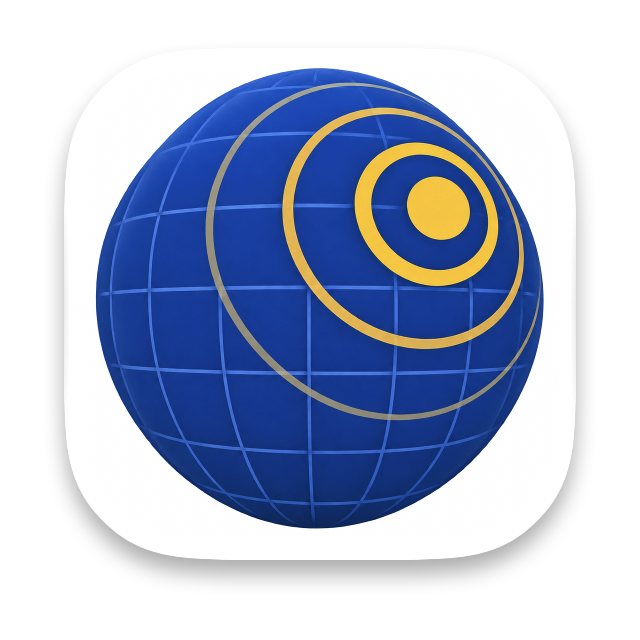
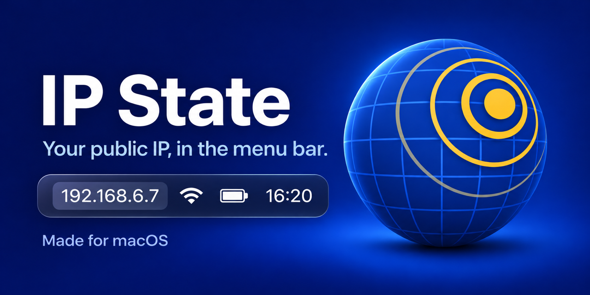
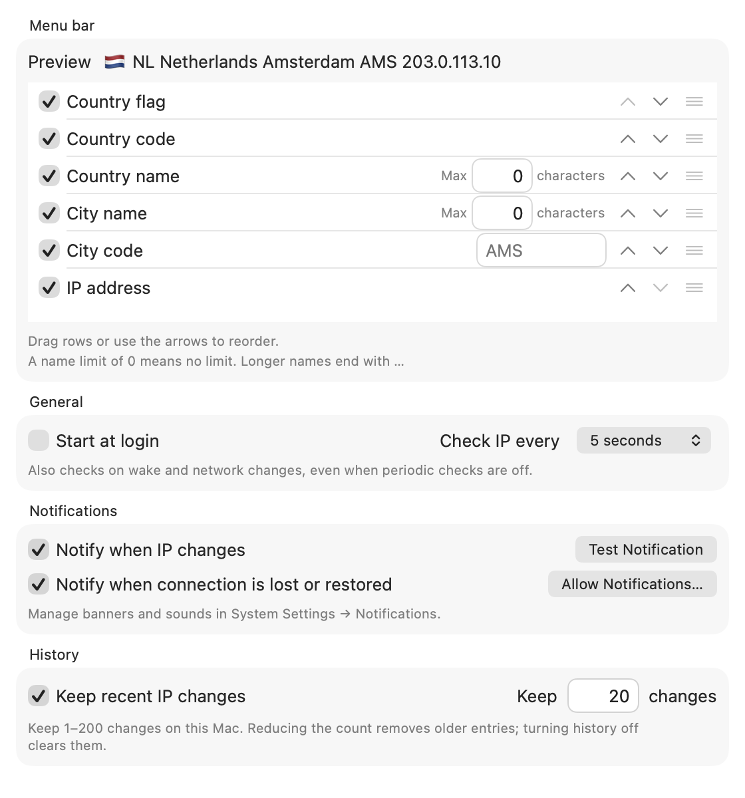

<p align="center">
  
</p>

<h1 align="center">IP State</h1>

<p align="center">
  <strong>Your public IP, at a glance. 🌍</strong><br>
  Keep an eye on your VPN's exit IP, location, and connection status from the macOS menu bar.
</p>

<p align="center">
  🍎 macOS 14+ &nbsp;·&nbsp; 💻 Apple silicon &amp; Intel &nbsp;·&nbsp; 🆓 Free &amp; open source
</p>

<p align="center">
  <a href="https://github.com/hypnodron/IPState/releases/latest"><strong>⬇️ Download for macOS</strong></a>
  &nbsp;·&nbsp; <a href="docs/usage.md">📖 User guide</a>
  &nbsp;·&nbsp; <a href="docs/privacy.md">🔒 Privacy</a>
</p>

<p align="center">
  
</p>

## ✨ Keep your connection in view

Switch VPN locations, reconnect to Wi-Fi, or change networks. See your current public IP without opening a browser.

- 🌍 **See your exit location.** Show your IP, country flag, country code, city, or a combination.
- 🔔 **Catch IP changes.** Get an alert with the new address and available location details.
- ⚡ **Follow network changes.** Check on wake and network changes, plus every 5 seconds to 15 minutes—or turn periodic checks off.
- 🧩 **Make the menu bar yours.** Pick and reorder items, limit long names, and set your own city codes.
- 📡 **Spot connection problems.** See an offline indicator and enable optional connection loss and recovery alerts.
- 🔀 **Track IPv4 and IPv6.** Monitor both independently and automatically show an available address in the menu bar.
- 🕘 **Remember recent IPs.** Opt into local change history. Returning IPs reuse cached locations while fresh lookups run when needed.
- 🍎 **Feel at home on Mac.** Native SwiftUI, quick address copying, optional start at login, and no Dock icon.
- 🔄 **Update from the app.** Check for signed app updates manually or daily, with optional preview releases and confirmation before installation.

<p align="center">
  
</p>

*Settings preview uses illustrative location data and example IP addresses.*

## 🚀 Get started

1. **[Download the universal macOS DMG](https://github.com/hypnodron/IPState/releases/latest)** from the latest stable release.
2. Open the disk image. Drag **IP State.app** onto the **Applications** shortcut.
3. Eject the disk image. Open **IP State** from Applications.
4. Click its menu bar item, then choose **Settings…** to make it yours.

A **ZIP** download is also available. Extract it and move **IP State.app** into **Applications**.

> [!NOTE]
> The downloadable app is ad-hoc signed and **not yet notarized by Apple**. macOS may block its first launch.
> If you choose to open it, follow [Apple's instructions for an unidentified developer's app](https://support.apple.com/guide/mac-help/mh40617/mac).

After installation, use **Check for Updates…** for future releases. Daily checks and preview updates are opt-in.
Versions before 0.11.0 need this manual installation once to enable app updates.

## 🔒 Clear about privacy

**No accounts, ads, or app analytics.** No location permission or application server.

Your preferences, cached locations, and optional history stay on your Mac. History is off by default.
Public IP and location lookups contact third-party services, which receive your public IP.
Four location providers offer automatic fallbacks when a lookup fails.

Read [Privacy and network requests](docs/privacy.md) for providers, update checks, and local storage details.

## ℹ️ What to expect

- ⏱️ Checks default to every five seconds and also run on wake and network changes. Changes between checks can be missed.
- 🌐 Country and city are approximate IP locations. IPv4, IPv6, split tunnels, and proxies can give other apps different exit routes.
- 🟡 The first result sets a silent baseline. Failed lookups keep the last result and mark it stale.
- 🔔 macOS controls notification permission, banners, sounds, and Focus behavior.

See the [user guide](docs/usage.md) for full behavior and [default settings](docs/defaults.md) for the initial configuration.

## 🛠️ Build from source

<details>
<summary>Developer setup and commands</summary>

Use Xcode with Swift 6 and Icon Composer. Swift Package Manager downloads the pinned [Sparkle](https://sparkle-project.org/) updater.

Build and open the app:

```sh
bash Scripts/build-app.sh
open "build/IP State.app"
```

Build for both Apple silicon and Intel:

```sh
bash Scripts/build-app.sh --universal
```

Run the deterministic tests:

```sh
bash Scripts/swift.sh test
python3 -m unittest discover -s Tests/ReleaseTools -v
```

Build products and compiler caches stay in `.build/` and `build/`.
See [Contributing](CONTRIBUTING.md) for development guidance and [the release guide](docs/releasing.md) for packaging.

### Project layout

- `Sources/IPStateCore` — lookups, monitoring, preferences, and display formatting.
- `Sources/IPState` — native menu bar interface, settings, notifications, and lifecycle.
- `Tests` — deterministic regression tests and opt-in live checks.
- `Support/AppIcon.icon` — the modern Icon Composer source.
- `Scripts` — build, test, and packaging commands.

</details>

## 💬 Feedback & contributions

🐛 [Report a bug](https://github.com/hypnodron/IPState/issues/new?template=bug_report.yml) or 💡 [suggest a feature](https://github.com/hypnodron/IPState/issues/new?template=feature_request.yml).
Code contributions are welcome—see [Contributing](CONTRIBUTING.md) to get started.

## 📄 License

[MIT](LICENSE) · Copyright 2026 hypnodron.

---

👉 [Check out my other projects](https://hypnodron.com)
