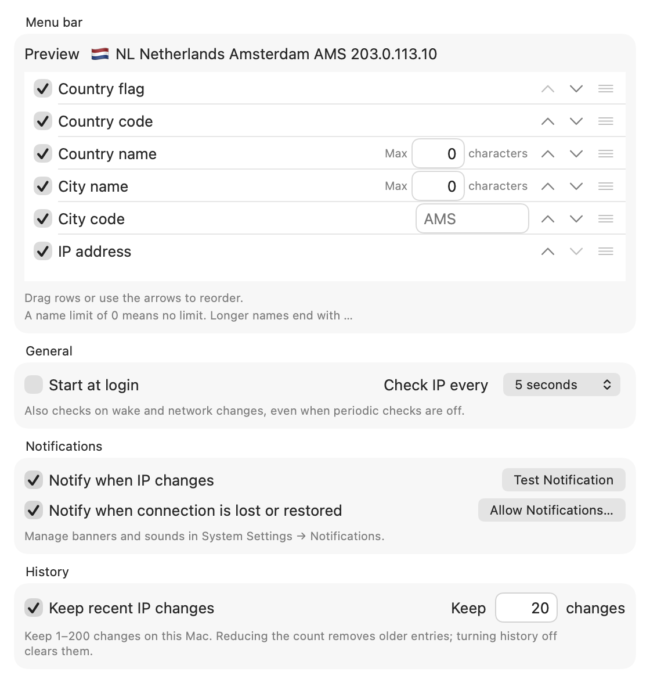

<p align="center">
  
</p>

# IP State

Your public IP, location, and connection status in the macOS menu bar.
Get a notification when your public IP changes.

**macOS 14+ · Apple silicon and Intel · Native SwiftUI · No external packages**

## Features

- Show an IP address, country flag, country code, country name, city, or editable city code.
- Choose which items appear and reorder them. Limit long city and country names.
- Track IPv4 and IPv6 independently; automatically display an available address family.
- Check every 5 seconds to 15 minutes, or turn periodic checks off. Also check on wake and network changes.
- Receive IP-change alerts, plus optional connection loss and recovery alerts.
- Keep optional local IP history with a configurable retention count.
- Copy addresses, refresh manually, and optionally start at login.
- Use four location providers with automatic fallbacks.
- Remember recent IP locations across restarts, with automatic refresh and expiry.

<p align="center">
  
</p>

*Settings preview uses illustrative location data and example IP addresses.*

## Install

Download the universal macOS ZIP from [Releases](https://github.com/hypnodron/IPState/releases).
Extract it, move **IP State.app** into Applications, and open it.
The app lives in the menu bar and has no Dock icon. Click its menu bar item, then choose **Settings…**.

The first preview is ad-hoc signed and **not notarized by Apple**. macOS may block its first launch.
If you choose to open it, follow [Apple's instructions for an unidentified developer's app](https://support.apple.com/guide/mac-help/mh40617/mac).
You can also build the source yourself.

## Build from source

Use Xcode with Swift 6 and Icon Composer. There are no external package dependencies.

```sh
bash Scripts/build-app.sh
open "build/IP State.app"
```

To build for both Apple silicon and Intel:

```sh
bash Scripts/build-app.sh --universal
```

To run the deterministic tests:

```sh
bash Scripts/swift.sh test
```

Build products and compiler caches stay in `.build/` and `build/`.
See [Contributing](CONTRIBUTING.md) for development guidance and [the release guide](docs/releasing.md) for packaging.

## Behavior and privacy

The default refresh interval is five seconds. Network events and wake trigger immediate checks, including when periodic checks are off.
Changes can only be detected when a check runs; changes between checks may be missed.

The first successful result establishes a baseline without an alert. Failed lookups keep the last known result and mark it stale.
The menu bar updates before location enrichment finishes. macOS controls notification permission, banners, sounds, and Focus behavior.

Country and city are approximate IP-location results, not the Mac's physical location.
IPv4 and IPv6 can have different exits. Split tunnels and proxies may route other apps differently.

IP State has no account, analytics, application server, or location permission.
It contacts public IP and location services, which receive your public IP.
Preferences, cached locations, and optional history stay on your Mac. History is off by default.
See [Privacy and network requests](docs/privacy.md) for the exact providers and storage behavior.

For detailed settings, notification, and connection behavior, see [Using IP State](docs/usage.md).
See [Default settings](docs/defaults.md) for the initial configuration and its rationale for VPN users.

## Project layout

- `Sources/IPStateCore` — lookups, monitoring, preferences, and display formatting.
- `Sources/IPState` — native menu bar interface, settings, notifications, and lifecycle.
- `Tests` — deterministic regression tests and opt-in live checks.
- `Support/AppIcon.icon` — the modern Icon Composer source.
- `Scripts` — build, test, and packaging commands.


## License

[MIT](LICENSE) · Copyright 2026 hypnodron.
